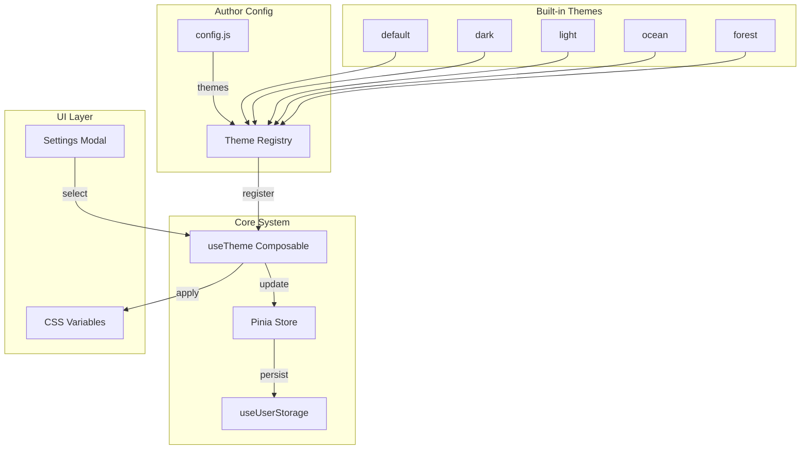

# VNova Theme System Architecture

## Overview

A flexible theming system that allows authors to customize the visual appearance of the VNova engine through CSS custom properties. Themes control **colors**, **typography**, and **layout** aspects. The system provides built-in default themes and supports custom theme registration.

## Architecture Diagram



## Component Design

### 1. Theme Definition Structure

```javascript
// src/theme/themes/default.js
export const defaultTheme = {
  id: 'default',
  name: 'Default',
  description: 'The classic VNova purple theme',
  variables: {
    // ═══════════════════════════════════════════════════════════
    // COLORS
    // ═══════════════════════════════════════════════════════════
    '--vnova-color-primary': '#a855f7',
    '--vnova-color-secondary': '#6366f1',
    '--vnova-color-text': '#e9d5ff',
    '--vnova-color-muted': '#9ca3af',
    '--vnova-color-dim': '#6b7280',
    '--vnova-color-surface': 'rgba(20, 15, 30, 0.9)',
    '--vnova-color-danger': '#c0392b',
    '--vnova-color-accent': '#4a6cf7',
    
    // ═══════════════════════════════════════════════════════════
    // TYPOGRAPHY
    // ═══════════════════════════════════════════════════════════
    '--vnova-font-body': "'Georgia', serif",
    '--vnova-font-ui': "'Outfit', system-ui, sans-serif",
    '--vnova-font-title': "'Cinzel', serif",
    
    // ═══════════════════════════════════════════════════════════
    // LAYOUT - Dialog
    // ═══════════════════════════════════════════════════════════
    '--vnova-dialog-height': '18%',
    '--vnova-dialog-padding': '0.8rem 1.2rem 0.95rem',
    '--vnova-dialog-bg': 'rgba(0, 0, 0, 0.56)',
    '--vnova-dialog-border': 'rgba(255, 255, 255, .12)',
    '--vnova-text-size': '1.15rem',
    '--vnova-text-line-height': '1.55',
    '--vnova-text-color': '#f0eaf8',
    '--vnova-think-color': '#d9d1e8',
    '--vnova-nameplate-size': '0.8rem',
    '--vnova-nameplate-color': '#fff',
    
    // ═══════════════════════════════════════════════════════════
    // LAYOUT - Choices
    // ═══════════════════════════════════════════════════════════
    '--vnova-choices-bg': 'rgba(0, 0, 0, .65)',
    '--vnova-choice-size': '0.95rem',
    '--vnova-choice-color': '#f0eaf8',
    '--vnova-choice-bg': 'rgba(255, 255, 255, .08)',
    '--vnova-choice-border': 'rgba(255, 255, 255, .2)',
    '--vnova-choice-bg-hover': 'rgba(255, 255, 255, .18)',
    '--vnova-choice-radius': '6px',
    
    // ═══════════════════════════════════════════════════════════
    // LAYOUT - Modals
    // ═══════════════════════════════════════════════════════════
    '--vnova-modal-bg': 'rgba(20, 15, 30, 0.9)',
    '--vnova-modal-border': 'rgba(168, 85, 247, 0.25)',
    '--vnova-modal-radius': '12px',
    '--vnova-modal-shadow': '0 10px 40px rgba(0, 0, 0, 0.5)',
    '--vnova-modal-max-width': '500px',
    '--vnova-modal-max-height': '80vh',
    
    // ═══════════════════════════════════════════════════════════
    // LAYOUT - Stage
    // ═══════════════════════════════════════════════════════════
    '--vnova-stage-bg': '#000',
    '--vnova-bg-duration': '400ms',
    '--vnova-sprite-bottom': '0px',
    
    // ═══════════════════════════════════════════════════════════
    // HUD (new variables to be added to vnova.css)
    // ═══════════════════════════════════════════════════════════
    '--vnova-hud-bg': 'rgba(14, 10, 24, 0.78)',
    '--vnova-hud-border': 'rgba(240, 234, 248, 0.2)',
    '--vnova-hud-text': 'rgba(245, 239, 252, 0.88)',
  }
}
```

### 2. Theme Registry Module

**File**: `src/theme/index.js`

```javascript
// Registry of all available themes
const themes = new Map()

// Register a theme
export function registerTheme(theme) {
  if (!theme.id || !theme.variables) {
    console.warn('Invalid theme: must have id and variables')
    return false
  }
  themes.set(theme.id, theme)
  return true
}

// Get a theme by ID
export function getTheme(id) {
  return themes.get(id)
}

// Get all registered themes
export function getAllThemes() {
  return Array.from(themes.values())
}

// Check if theme exists
export function hasTheme(id) {
  return themes.has(id)
}

// Remove a theme (except built-ins)
export function unregisterTheme(id) {
  const builtIn = ['default', 'dark', 'light', 'ocean', 'forest']
  if (builtIn.includes(id)) {
    console.warn('Cannot unregister built-in theme:', id)
    return false
  }
  return themes.delete(id)
}
```

### 3. useTheme Composable

**File**: `src/composables/useTheme.js`

```javascript
import { computed, watch } from 'vue'
import { useVNovaStore } from '../core/store.js'
import { getTheme, getAllThemes, registerTheme } from '../theme/index.js'

export function useTheme() {
  const store = useVNovaStore()
  
  // Current theme ID from store
  const currentThemeId = computed({
    get: () => store.settings.theme || 'default',
    set: (id) => store.setSetting({ key: 'theme', value: id })
  })
  
  // Current theme object
  const currentTheme = computed(() => getTheme(currentThemeId.value))
  
  // List of available themes
  const availableThemes = computed(() => getAllThemes())
  
  // Apply theme to DOM
  function applyTheme(themeId) {
    const theme = getTheme(themeId)
    if (!theme) {
      console.warn('Theme not found:', themeId)
      return false
    }
    
    const root = document.documentElement
    Object.entries(theme.variables).forEach(([prop, value]) => {
      root.style.setProperty(prop, value)
    })
    
    // Store the selection
    store.setSetting({ key: 'theme', value: themeId })
    return true
  }
  
  // Initialize theme on mount
  function initTheme() {
    const savedTheme = store.settings.theme || 'default'
    applyTheme(savedTheme)
  }
  
  // Register custom themes from config
  function registerThemes(themes) {
    if (!Array.isArray(themes)) return
    themes.forEach(theme => registerTheme(theme))
  }
  
  return {
    currentThemeId,
    currentTheme,
    availableThemes,
    applyTheme,
    initTheme,
    registerThemes
  }
}
```

### 4. Store Integration

**File**: `src/core/store.js` (modifications)

```javascript
const defaultSettings = () => ({
  typewriterSpeed: 30,
  bgmVolume: 0.5,
  sfxVolume: 0.5,
  textSize: 'medium',
  spacebarFastForward: 'fullspeed',
  theme: 'default',  // NEW: Add theme to settings
})
```

### 5. Settings Modal UI

**File**: `src/components/VNovaSettingsModal.vue` (additions)

```vue
<!-- Add to template -->
<div class="vnova-setting-group">
  <label>{{ t('settings.theme') }}</label>
  <div class="vnova-theme-grid">
    <button
      v-for="theme in availableThemes"
      :key="theme.id"
      type="button"
      class="vnova-theme-card"
      :class="{ 'vnova-theme-card--active': currentThemeId === theme.id }"
      @click="onThemeSelect(theme.id)"
    >
      <div class="vnova-theme-preview" :style="getThemePreviewStyle(theme)">
        <div class="vnova-theme-swatch" :style="{ background: theme.variables['--vnova-color-primary'] }"></div>
        <div class="vnova-theme-swatch" :style="{ background: theme.variables['--vnova-color-secondary'] }"></div>
      </div>
      <span class="vnova-theme-name">{{ theme.name }}</span>
    </button>
  </div>
</div>
```

### 6. Config Integration

**File**: `docs-example/src/story/config.js` (additions)

```javascript
export const defaultConfig = {
  // ... existing config
  
  // Custom themes
  themes: [
    {
      id: 'cyberpunk',
      name: 'Cyberpunk',
      description: 'Neon lights and dark streets',
      variables: {
        '--vnova-color-primary': '#ff00ff',
        '--vnova-color-secondary': '#00ffff',
        '--vnova-color-surface': 'rgba(10, 0, 20, 0.95)',
        // ... more overrides
      }
    }
  ]
}
```

## Implementation Steps

### Phase 1: Core Theme System
1. Create `src/theme/index.js` - Theme registry
2. Create `src/theme/themes/` directory with default themes
3. Create `src/composables/useTheme.js` - Theme composable
4. Update `src/core/store.js` - Add theme to settings

### Phase 2: UI Integration
5. Update `src/components/VNovaSettingsModal.vue` - Add theme selector
6. Update `src/components/VNovaRuntime.vue` - Initialize theme on mount
7. Add CSS for theme preview cards

### Phase 3: Author API
8. Update `src/index.js` - Export theme utilities
9. Update config schema to accept themes array
10. Add theme registration in engine initialization

### Phase 4: Documentation
11. Update `docs/guide/no-code.md` - Document theme configuration
12. Add theme examples to `docs-example/`

## Default Themes

| Theme | Description | Primary Color |
|-------|-------------|---------------|
| `default` | Classic VNova purple | `#a855f7` |
| `dark` | Pure dark mode | `#3b82f6` |
| `light` | Light theme | `#6366f1` |
| `ocean` | Blue/cyan aquatic | `#06b6d4` |
| `forest` | Green nature | `#22c55e` |

## CSS Variables to Theme

Based on `vnova.css`, themes can control three categories:

### Colors
- `--vnova-color-primary`
- `--vnova-color-secondary`
- `--vnova-color-text`
- `--vnova-color-muted`
- `--vnova-color-dim`
- `--vnova-color-surface`
- `--vnova-color-danger`
- `--vnova-color-accent`

### Typography
- `--vnova-font-body` — Main text font (dialog, backlog)
- `--vnova-font-ui` — UI elements (buttons, HUD, labels)
- `--vnova-font-title` — Titles and headings

### Layout
**Dialog**
- `--vnova-dialog-height` — Height of dialog box
- `--vnova-dialog-padding` — Padding inside dialog
- `--vnova-dialog-bg` — Dialog background
- `--vnova-dialog-border` — Dialog border
- `--vnova-text-size` — Main text size
- `--vnova-text-line-height` — Line height
- `--vnova-text-color` — Text color
- `--vnova-think-color` — Thought text color
- `--vnova-nameplate-size` — Character name size
- `--vnova-nameplate-color` — Character name color

**Choices**
- `--vnova-choices-bg` — Choices container background
- `--vnova-choice-size` — Choice button text size
- `--vnova-choice-color` — Choice text color
- `--vnova-choice-bg` — Choice button background
- `--vnova-choice-border` — Choice button border
- `--vnova-choice-bg-hover` — Choice hover background
- `--vnova-choice-radius` — Choice button border radius

**Modals**
- `--vnova-modal-bg` — Modal background
- `--vnova-modal-border` — Modal border
- `--vnova-modal-radius` — Modal border radius
- `--vnova-modal-shadow` — Modal box shadow
- `--vnova-modal-max-width` — Modal max width
- `--vnova-modal-max-height` — Modal max height

**Stage**
- `--vnova-stage-bg` — Stage background color
- `--vnova-bg-duration` — Background transition duration
- `--vnova-sprite-bottom` — Sprite bottom position

**HUD** (new variables to be added to vnova.css)
- `--vnova-hud-bg` — HUD strip background
- `--vnova-hud-border` — HUD strip border
- `--vnova-hud-text` — HUD text color

## Persistence Strategy

Theme selection is persisted via the existing settings mechanism:
1. User selects theme in Settings Modal
2. `useTheme.applyTheme()` updates CSS variables and store
3. Store's `settings.theme` is saved via `useVNovaSaves`
4. On load, `useTheme.initTheme()` restores the saved theme

## Author Extension Points

```javascript
// 1. Register custom themes via config
export const config = {
  themes: [
    { id: 'custom', name: 'My Theme', variables: { ... } }
  ]
}

// 2. Register themes programmatically
import { useTheme } from 'vnova-engine'
const { registerThemes } = useTheme()
registerThemes([{ id: 'dynamic', name: 'Dynamic', variables: { ... } }])

// 3. Override individual variables via CSS
:root {
  --vnova-color-primary: #ff0000;
}
```

## Migration Notes

- Existing projects continue to work without changes
- Default theme matches current styling
- Theme selection is optional (falls back to 'default')
- CSS custom property overrides still work as before
